# Database

PostgreSQL, accessed with Prisma. The schema in `prisma/schema.prisma` is the source of truth (50 tables). This file explains the rules around it, what Prisma cannot express, seed data, and the ERD.

## 1. Conventions

- UUID primary keys (`@default(uuid())`), except `Setting.key` (natural key) and join tables (composite keys).
- Money: `Decimal(12,2)` (delivery zone charge `Decimal(10,2)`). Currency is always BDT.
- Timestamps are UTC (`createdAt`, `updatedAt`). Display in Asia/Dhaka.
- Table names are `snake_case` plural via `@@map`; column names keep Prisma's camelCase.
- Phones are stored normalized (`01XXXXXXXXX`); emails lowercase.
- Order, item and address data are **snapshots**: later product or address edits never change past orders.
- Soft delete only on `Product.deletedAt`. Everything else is hard delete with the cascade rules in the schema.

## 2. Prisma setup note

The datasource has no `url` in the schema file. With current Prisma majors the connection URL lives in `prisma.config.ts` at the repo root and the client uses a driver adapter. When scaffolding, follow the current official Prisma docs for Postgres, roughly:

```ts
// prisma.config.ts
import 'dotenv/config'; // Prisma 7 does not load .env by itself
import { defineConfig, env } from 'prisma/config';

export default defineConfig({
  schema: 'prisma/schema.prisma',
  migrations: { path: 'prisma/migrations' },
  datasource: { url: env('DATABASE_URL') },
});
```

The client is generated to `apps/api/src/generated/prisma` (see the generator block). Do not commit the generated folder.

## 3. Tables by module

| Module | Tables | Notes |
|---|---|---|
| Identity | `customers`, `customer_addresses`, `admin_users`, `roles`, `permissions`, `role_permissions` | Customer phone unique and mandatory. Customer email unique and required by Better Auth: phone-only customers get `<phone>@phone.invalid` (never verified or mailed). Admin has one role |
| Auth (Better Auth, see `auth.md`) | `customer_sessions`, `customer_accounts`, `customer_verifications`, `admin_sessions`, `admin_accounts`, `admin_verifications`, `admin_two_factors` | Columns follow Better Auth's core schema. Passwords (scrypt) live in `*_accounts.password` with `providerId = 'credential'`. Sessions and verification records are stored in Postgres and mirrored in Redis |
| Media | `media` | Base path plus alt text; derived sizes are generated on disk |
| Catalog | `categories`, `brands`, `products`, `product_variants`, `product_images`, `tags`, `product_tags`, `attributes`, `attribute_values`, `variant_attribute_values` | Price lives on variants. Categories nest through `parentId`. Variants carry a structured net content (`unit` + `unitValue`) and optional attributes |
| Inventory | `inventory_batches`, `stock_movements` | Batches optional. Every stock change writes a movement |
| Cart | `carts`, `cart_items` | One cart per customer or per guest `sessionToken` |
| Orders | `orders`, `order_addresses`, `order_items`, `order_status_history`, `order_notes` | Guest orders have `customerId = null` |
| Payments | `payment_methods`, `payments`, `refunds` | `payment_methods.isActive` is the admin toggle |
| Shipping | `delivery_zones`, `shipments`, `courier_events` | `delivery_zones.isActive` is the admin toggle |
| Marketing | `coupons`, `coupon_usages`, `banners`, `homepage_sections`, `redirects` | |
| Engagement | `reviews`, `review_images`, `wishlist_items` | |
| System | `settings`, `notification_logs`, `audit_logs` | |

## 3a. Units and attributes

Each variant describes what the customer buys in three layers:

| Layer | Fields | Example (honey) | Used for |
|---|---|---|---|
| Net content | `unit` (`G`, `KG`, `ML`, `L`, `PCS`, `DOZEN`, `PACK`) + `unitValue` | `G` + `500` | Display, sorting by size, price-per-unit |
| Display label | `name` | `500 g` | Shown in the variant picker and order snapshot. Generate it from `unitValue` + `unit` (for example `500 g`, `1.5 L`), and allow an admin override |
| Shipping weight | `weightGrams` | `720` | Courier parcel weight, includes bottle and packaging. Not the same as net content |
| Extra attributes | `attributes` -> `attribute_values` -> `variant_attribute_values` | Flavor = Classic Malt | Variant options and storefront filters |

Rules:

- `unit` and `unitValue` are both set or both null (CHECK in the raw SQL migration).
- A variant has at most one value per attribute (enforced in the service, because it spans tables).
- Attributes are managed in admin (Catalog > Attributes). `isFilterable` controls whether an attribute appears as a storefront filter.
- Price per unit for display (for example "Tk 12 per 100 g") is computed in code from `price`, `unit` and `unitValue`; it is not stored.
- Seed examples: attribute `Flavor` (Plain, Classic Malt, Chocolate), attribute `Type` (Regular, Organic). Units are an enum, not seed data.
- Product-level facts that do not vary by variant (ingredients, nutrition facts, shelf life, origin) stay on `products`.

## 4. Rules Prisma cannot express (put in a raw SQL migration)

Create these in a hand-written migration (`prisma migrate dev --create-only`, then edit the SQL):

```sql
CREATE EXTENSION IF NOT EXISTS pg_trgm;

ALTER TABLE product_variants ADD CONSTRAINT chk_variant_stock CHECK ("stockQty" >= 0);
ALTER TABLE product_variants ADD CONSTRAINT chk_variant_price CHECK (price >= 0 AND ("salePrice" IS NULL OR ("salePrice" >= 0 AND "salePrice" < price)));
ALTER TABLE product_variants ADD CONSTRAINT chk_variant_unit CHECK (("unit" IS NULL) = ("unitValue" IS NULL) AND ("unitValue" IS NULL OR "unitValue" > 0));
ALTER TABLE cart_items       ADD CONSTRAINT chk_cart_qty   CHECK (quantity > 0);
ALTER TABLE order_items      ADD CONSTRAINT chk_item_qty   CHECK (quantity > 0);

-- pricing integrity (see docs/pricing.md): the database refuses inconsistent money
ALTER TABLE order_items ADD CONSTRAINT chk_item_amounts CHECK (
  "unitPrice" >= 0 AND "listPrice" >= "unitPrice" AND "discountAmount" >= 0
  AND "lineTotal" = "unitPrice" * quantity AND "discountAmount" <= "lineTotal");
ALTER TABLE orders ADD CONSTRAINT chk_order_amounts CHECK (
  subtotal >= 0 AND "discountTotal" >= 0 AND "deliveryCharge" >= 0
  AND "discountTotal" <= subtotal
  AND "grandTotal" = subtotal - "discountTotal" + "deliveryCharge" AND "grandTotal" >= 0);
ALTER TABLE coupons ADD CONSTRAINT chk_coupon_value CHECK (
  value > 0 AND (type <> 'PERCENT' OR value <= 100));
ALTER TABLE payments ADD CONSTRAINT chk_payment_amount CHECK (amount > 0);
ALTER TABLE refunds  ADD CONSTRAINT chk_refund_amount  CHECK (amount > 0);
ALTER TABLE reviews          ADD CONSTRAINT chk_rating     CHECK (rating BETWEEN 1 AND 5);

-- one default address per customer, one primary image per product, one default zone
CREATE UNIQUE INDEX uq_default_address ON customer_addresses ("customerId") WHERE "isDefault";
CREATE UNIQUE INDEX uq_primary_image   ON product_images ("productId") WHERE "isPrimary";
CREATE UNIQUE INDEX uq_default_zone    ON delivery_zones ((true)) WHERE "isDefault";

-- search: trigram indexes (and a tsvector column if full-text ranking is needed)
CREATE INDEX idx_products_name_trgm ON products USING gin (name gin_trgm_ops);
CREATE INDEX idx_products_slug_trgm ON products USING gin (slug gin_trgm_ops);
```

## 5. Business rules the code must keep

**Addresses and zones.** Division, district and upazila names come from `packages/shared/src/bd-geo-data.ts` (generated from github.com/nuhil/bangladesh-geocode, MIT; 8 divisions, 64 districts, 495 upazilas). The server checks that the district is in the division and the upazila in the district (`checkBdAddress()`). The upazila is optional, because city areas (for example Mirpur in Dhaka) are not upazilas. A district belongs to at most one delivery zone; the default zone covers all other districts; a zone used by orders is turned off, not deleted.

**Order number.** `orderSeq` is a database sequence; `orderNumber = 'ORD-' + zero-padded orderSeq` (6 digits).

**Order creation** (one transaction, idempotent on `idempotencyKey`):

1. If an order with the key exists, return it.
2. Load variants; require `isActive`, product `ACTIVE`, enough stock.
3. Resolve the delivery zone from the address district; require the zone `isActive`; apply the free-delivery threshold.
4. Require the payment method `isActive`; for COD apply the `config.scope` rule (`DHAKA_ONLY` allows only the inside-Dhaka zone, `NATIONWIDE` allows all).
5. Validate the coupon (active, dates, min order, usage limit, per-customer limit by customer or phone) and compute prices, discount, delivery and totals with `calculateOrderTotals()`. The exact rules, rounding and discount allocation are in `pricing.md`; nothing in this step uses amounts from the request.
6. Insert `orders`, `order_addresses`, `order_items` (snapshots including `listPrice`, `unitPrice`, `lineTotal` and the allocated `discountAmount`), first `order_status_history` row.
7. Decrement stock with a conditional update (`SET "stockQty" = "stockQty" - n WHERE id = ? AND "stockQty" >= n`); if zero rows updated, abort. Write a `stock_movements` row (`SALE`, negative quantity, `balanceAfter`).
8. Insert `coupon_usages`, increment `coupons.usedCount` conditionally.
9. Commit, then enqueue emails and clear the cart. For online payment, create a `payments` row and call the gateway adapter after commit.

**Cancel or failed payment.** Restore stock (`CANCEL_RELEASE` movements), restore coupon usage, write status history.

**Guest linking.** Only in Better Auth's after-email-verification hook (and after a verified email change), run `UPDATE orders SET customerId = ? WHERE customerId IS NULL AND contactEmail = ?` with the verified email. Never link by phone alone. Placeholder `@phone.invalid` emails are never verified, so they never link. See `auth.md` section 4.

**Products and variants (admin).** A product can be `ACTIVE` only with at least one active variant, and the last active variant of an active product cannot be deactivated or deleted (set the product to draft first). A variant has at most one value per attribute. Its label is generated from the net content (`variantLabel()`: `500 g`, `1.5 L`) unless the admin types one, and follows the net content while it is still the generated one. Price per unit (`pricePerUnit()`: per 100 g, 100 ml or piece) is display only. Stock is never edited on the variant: a new variant's opening stock is a `PURCHASE` movement in the same transaction, everything else goes through inventory adjustments. A variant with stock movements or order items cannot be deleted (`VARIANT_HAS_HISTORY`); deactivate it. Deleting a product is a soft delete (`deletedAt`, status `ARCHIVED`); its slug stays taken. Images are set as one ordered list; the first is the primary one (`uq_primary_image`).

**CSV import and export (CAT-7).** One row per variant; product columns repeat on each of its rows. Columns: `product_slug, product_name, category_slug, brand_slug, status, short_description, description, is_featured, is_new_arrival, is_best_seller, ingredients, nutrition_facts, shelf_life, origin, seo_title, seo_description, tags, sku, variant_label, unit, unit_value, price, sale_price, weight_grams, barcode, low_stock_threshold, variant_active, attributes, stock` (required headers: `product_slug, product_name, category_slug, sku`). Tags are slugs separated by `;`; attributes and nutrition facts are `Name=Value;Name=Value`; money like `450.00`; booleans `true`/`false`. Products match by `product_slug`, variants by `sku` (create or update; a SKU of another product is an error); a row with an empty `sku` and no variant data is a product-only row. Categories, brands, tags and attribute values must exist. `stock` is used only for new variants (a `PURCHASE` movement, reason `CSV import`); existing stock is changed only through inventory adjustments. An empty `variant_label` means "generated from the net content". Every import is fully validated first (per-row report); applying writes everything in one transaction or nothing. Export neutralises spreadsheet formulas (a cell starting with `= + - @` gets a leading `'`, removed again on import) and starts with a UTF-8 BOM for Excel. Images are not part of the CSV.

**Storefront visibility and search.** Public endpoints show only products that are `ACTIVE`, not deleted and have at least one active variant; only active variants; only active categories whose ancestors are all active (a hidden category hides its subtree); only active brands. Product price on listings is the cheapest effective price (sale price if set) over active variants, computed in SQL for filtering and sorting and in integer paisa for display. Exact stock is never public (`inStock`, `lowStock` only). Search uses the GIN expression index `idx_products_fts` on `to_tsvector('simple', name || ' ' || coalesce("shortDescription", ''))` (migration `20261116000000`; the query must use the same expression) plus the trigram index on name; LIKE wildcards in queries are escaped.

**Homepage sections.** `config` per type (validated with `sectionConfigSchemas`): `CATEGORY_GRID` `{ categoryIds? }` (empty: active top-level categories); `PRODUCT_LIST` `{ source: featured | new | bestsellers | category | manual, categoryId?, productIds?, limit? (max 24, default 8) }`; `BANNER_STRIP` `{ position }`; `CUSTOM_HTML` `{ text }`, shown as a plain text block and never rendered as HTML (Phase 5 decision; the enum name is kept). With no sections configured, the homepage shows Featured, Shop by category, New arrivals and Best sellers. Banner positions: `home_hero` (top slider), `home_strip`.

**Slugs and redirects.** Slugs are generated from the name when left empty (`slugify()` in `packages/shared`; names without Latin letters need a typed slug) and never change on rename. An explicit slug change inserts a `redirects` row (`/category/old` -> `/category/new`, 301; products use `/product/...`), points earlier redirects at the new path so there are no chains, and removes any redirect from the new path (it is a live page again). Phase 5 serves them.

**Ratings.** After a review is created, edited, approved, rejected or deleted, recompute `products.ratingAvg` (two decimals) and `ratingCount` from approved reviews, in the same transaction; the product page cache tag is refreshed.

**Review photos.** Up to 3 per review, uploaded through the normal image pipeline into `media` under `reviews/` (kept out of the admin media library). A fresh upload is reserved for its customer for 24 h (Redis); unattached ones are deleted hourly.

**Wishlist.** `wishlist_items` per customer (max 200). Guests keep product ids in the browser (localStorage); the first signed-in page view merges them into the account and clears the local list.

**Reviews allowed** only when the customer has an order item for the product whose order is `DELIVERED`; set `isVerifiedPurchase` and `orderItemId`. Customers may edit (back to PENDING unless auto-approve) or delete their own review. Text is plain text, never rendered as HTML.

**Inventory.** Every stock change is one atomic statement (`UPDATE ... SET "stockQty" = "stockQty" + n WHERE ... AND "stockQty" + n >= 0 RETURNING "stockQty"`) in the same transaction as its `stock_movements` row, whose `balanceAfter` is the returned value, so concurrent changes never overdraw or record wrong balances. Adjustments need a reason (`ADJUSTMENT`); goods received are a `PURCHASE`, optionally as a batch (`batchNo` unique per variant, optional manufacture and expiry dates, `qtyRemaining` tracked when an adjustment names the batch).

**Low stock.** After any committed stock change, if `stockQty <= lowStockThreshold`, email `notifications.adminEmail` (skipped when empty) with the `admin-low-stock` template, at most once per variant per 24 hours (Redis key `lowstock:alerted:<variantId>`, cleared when stock is back above the alert level, so the next drop alerts again). A failed check never fails the stock change.

**Super Admin.** The `roles` row with `isSystem = true` is always granted all permissions in code; it is not edited through the UI.

## 6. Seed data

**Permissions** (key, module): `products.view|create|update|delete`, `categories.manage`, `brands.manage`, `media.upload`, `inventory.view|adjust`, `orders.view|update_status|edit|cancel|book_courier|add_note`, `customers.view|block`, `reviews.moderate`, `coupons.manage`, `marketing.manage` (banners, sections, redirects), `payments.toggle|refund`, `shipping.manage`, `settings.manage`, `roles.manage`, `users.manage`, `reports.view`, `audit.view`. Roles that already exist keep their permissions when the seed runs again; grant new keys (such as `payments.refund`, added in Phase 7) in Roles.

**Roles:** `Super Admin` (system), `Manager` (everything except `roles.manage`, `users.manage`, `settings.manage`), `Salesman` (`products.view`, `orders.view`, `orders.update_status`, `orders.add_note`, `customers.view`).

**Payment methods:** `COD` (`config: { "scope": "DHAKA_ONLY" }`, active), `UDDOKTAPAY` (active).

**Delivery zones:** `inside-dhaka` (districts `["Dhaka"]`), `outside-dhaka` (default zone). Charges are placeholders until the owner sets them in admin. "Inside Dhaka" means the district `Dhaka` for now; refine by upazila or area later if needed.

**Super Admin user:** created through `adminAuth`'s internal adapter and password hasher, never by writing a hash. In development the seed does this from `SEED_ADMIN_EMAIL` and `SEED_ADMIN_PASSWORD` (skipped when `NODE_ENV=production`). Production uses `node dist/create-super-admin.js` with `SUPER_ADMIN_EMAIL`, `SUPER_ADMIN_NAME` and `SUPER_ADMIN_PASSWORD` (at least 12 characters). Both are idempotent.

**Settings keys:** `store.name`, `store.logo`, `store.phone`, `store.email`, `store.address`, `seo.defaultTitle`, `seo.defaultDescription`, `gtm.containerId`, `home.highlights`, `review.autoApprove`, `notifications.adminEmail`, `shipping.steadfastEnabled`. Each key's value rule, group and public flag are defined once in `packages/shared/src/settings.ts` (`SETTING_DEFINITIONS`); the admin API accepts only these keys, and a test checks that the seeded rows match. Notable rules: `store.phone` is empty or a Bangladeshi mobile number (saved normalized, per the phone rule); `store.logo` is an absolute `http(s)` URL or null (it is also used in emails); `gtm.containerId` is empty or `GTM-XXXX`; SEO title up to 70 and description up to 160 characters; `home.highlights` is a list of at most 4 `{ icon, title, text }` (empty: automatic), edited through `/admin/homepage/highlights` with `marketing.manage`.

## 7. Migration workflow

- `prisma migrate dev` locally; commit migrations; `prisma migrate deploy` in the production container start-up step (before the API starts).
- Never edit an applied migration. Destructive changes need a two-step migration.
- The partial unique indexes and trigram indexes from section 4 are not in the Prisma schema. When `migrate dev` generates a new migration, check that it does not add `DROP INDEX` for them; remove any such lines before applying.
- Seed is idempotent (upserts by unique key). Run it with `pnpm db:seed` (it builds and runs the seed bundled with the API, so it can use the API's dependencies).

## 8. ERD

Render with VS Code (Markdown Preview Mermaid Support extension) or GitHub. Only keys and the main business columns are shown; the schema file has everything.

```mermaid
erDiagram
    Customer ||--o{ CustomerAddress : has
    Customer ||--o| Cart : owns
    Customer ||--o{ Order : places
    Customer ||--o{ Review : writes
    Customer ||--o{ WishlistItem : saves
    Customer ||--o{ CustomerSession : sessions
    Customer ||--o{ CustomerAccount : credentials
    Customer ||--o{ CouponUsage : uses

    Role ||--o{ AdminUser : assigned
    Role ||--o{ RolePermission : grants
    Permission ||--o{ RolePermission : in
    AdminUser ||--o{ AdminSession : sessions
    AdminUser ||--o{ AdminAccount : credentials
    AdminUser ||--o{ AdminTwoFactor : totp
    AdminUser ||--o{ AuditLog : acts
    AdminUser ||--o{ OrderNote : writes
    AdminUser ||--o{ OrderStatusHistory : changes
    AdminUser ||--o{ StockMovement : adjusts
    AdminUser ||--o{ Media : uploads
    AdminUser ||--o{ Shipment : books
    AdminUser ||--o{ Refund : creates

    Category ||--o{ Category : parent
    Category ||--o{ Product : contains
    Brand ||--o{ Product : makes
    Product ||--o{ ProductVariant : has
    Product ||--o{ ProductImage : shows
    Product ||--o{ ProductTag : tagged
    Tag ||--o{ ProductTag : in
    Product ||--o{ Review : receives
    Product ||--o{ WishlistItem : in
    Media ||--o{ ProductImage : file
    Media ||--o{ Category : image
    Media ||--o{ Brand : logo
    Media ||--o{ Banner : image
    Media ||--o{ ReviewImage : file

    ProductVariant ||--o{ VariantAttributeValue : has
    Attribute ||--o{ AttributeValue : has
    AttributeValue ||--o{ VariantAttributeValue : used_in
    ProductVariant ||--o{ InventoryBatch : stocked
    ProductVariant ||--o{ StockMovement : moves
    InventoryBatch ||--o{ StockMovement : from
    ProductVariant ||--o{ CartItem : in
    Cart ||--o{ CartItem : holds
    ProductVariant ||--o{ OrderItem : sold

    Order ||--|| OrderAddress : ships_to
    Order ||--o{ OrderItem : contains
    Order ||--o{ OrderStatusHistory : timeline
    Order ||--o{ OrderNote : notes
    Order ||--o{ Payment : paid_by
    Order ||--o{ Shipment : shipped_by
    Order ||--o| CouponUsage : discount
    Order ||--o{ StockMovement : affects
    Order ||--o{ NotificationLog : emails
    PaymentMethod ||--o{ Order : chosen
    PaymentMethod ||--o{ Payment : via
    DeliveryZone ||--o{ Order : priced_by
    Coupon ||--o{ Order : applied
    Coupon ||--o{ CouponUsage : tracks
    Payment ||--o{ Refund : refunded
    Shipment ||--o{ CourierEvent : events
    OrderItem ||--o{ Review : proves
    Review ||--o{ ReviewImage : photos

    Customer {
        uuid id PK
        string phone UK
        string email UK
        bool emailVerified
        enum status
    }
    CustomerSession {
        uuid id PK
        uuid userId FK
        string token UK
        datetime expiresAt
    }
    CustomerAccount {
        uuid id PK
        uuid userId FK
        string providerId
        string password
    }
    CustomerAddress {
        uuid id PK
        uuid customerId FK
        string district
        string addressLine
        bool isDefault
    }
    Role {
        uuid id PK
        string name UK
        bool isSystem
    }
    Permission {
        uuid id PK
        string key UK
        string module
    }
    RolePermission {
        uuid roleId FK
        uuid permissionId FK
    }
    AdminUser {
        uuid id PK
        string email UK
        uuid roleId FK
        bool isActive
    }
    AdminSession {
        uuid id PK
        uuid userId FK
        string token UK
        datetime expiresAt
    }
    AdminAccount {
        uuid id PK
        uuid userId FK
        string providerId
        string password
    }
    AdminTwoFactor {
        uuid id PK
        uuid userId FK
        string secret
        string backupCodes
    }
    Media {
        uuid id PK
        string path UK
        string altText
        uuid uploadedById FK
    }
    Category {
        uuid id PK
        uuid parentId FK
        string slug UK
        uuid imageId FK
    }
    Brand {
        uuid id PK
        string slug UK
        uuid logoId FK
    }
    Product {
        uuid id PK
        string slug UK
        uuid categoryId FK
        uuid brandId FK
        enum status
        decimal ratingAvg
    }
    ProductVariant {
        uuid id PK
        uuid productId FK
        string sku UK
        decimal price
        decimal salePrice
        enum unit
        decimal unitValue
        int weightGrams
        int stockQty
    }
    ProductImage {
        uuid id PK
        uuid productId FK
        uuid mediaId FK
        bool isPrimary
    }
    Tag {
        uuid id PK
        string slug UK
    }
    ProductTag {
        uuid productId FK
        uuid tagId FK
    }
    Attribute {
        uuid id PK
        string name UK
        bool isFilterable
    }
    AttributeValue {
        uuid id PK
        uuid attributeId FK
        string value
    }
    VariantAttributeValue {
        uuid variantId FK
        uuid attributeValueId FK
    }
    InventoryBatch {
        uuid id PK
        uuid variantId FK
        string batchNo
        date expiryDate
        int qtyRemaining
    }
    StockMovement {
        uuid id PK
        uuid variantId FK
        uuid batchId FK
        uuid orderId FK
        enum type
        int quantity
    }
    Cart {
        uuid id PK
        uuid customerId FK
        string sessionToken UK
    }
    CartItem {
        uuid id PK
        uuid cartId FK
        uuid variantId FK
        int quantity
    }
    Order {
        uuid id PK
        string orderNumber UK
        uuid customerId FK
        string contactPhone
        string contactEmail
        enum status
        enum paymentStatus
        uuid paymentMethodId FK
        uuid deliveryZoneId FK
        uuid couponId FK
        decimal grandTotal
        string idempotencyKey UK
    }
    OrderAddress {
        uuid id PK
        uuid orderId FK
        string district
        string addressLine
    }
    OrderItem {
        uuid id PK
        uuid orderId FK
        uuid variantId FK
        string sku
        decimal listPrice
        decimal unitPrice
        int quantity
        decimal lineTotal
        decimal discountAmount
    }
    OrderStatusHistory {
        uuid id PK
        uuid orderId FK
        enum toStatus
        enum source
        uuid changedById FK
    }
    OrderNote {
        uuid id PK
        uuid orderId FK
        uuid adminUserId FK
    }
    PaymentMethod {
        uuid id PK
        string code UK
        bool isActive
        json config
    }
    Payment {
        uuid id PK
        uuid orderId FK
        uuid methodId FK
        decimal amount
        enum status
        string gatewayTxnId
    }
    Refund {
        uuid id PK
        uuid paymentId FK
        decimal amount
        enum status
    }
    DeliveryZone {
        uuid id PK
        string code UK
        string[] districts
        decimal charge
        bool isActive
    }
    Shipment {
        uuid id PK
        uuid orderId FK
        string consignmentId
        string trackingCode
        decimal codAmount
    }
    CourierEvent {
        uuid id PK
        uuid shipmentId FK
        string status
        enum source
    }
    Coupon {
        uuid id PK
        string code UK
        enum type
        decimal value
        int usedCount
    }
    CouponUsage {
        uuid id PK
        uuid couponId FK
        uuid orderId FK
        string phone
    }
    Banner {
        uuid id PK
        uuid imageId FK
        string position
        bool isActive
    }
    HomepageSection {
        uuid id PK
        enum type
        json config
    }
    Redirect {
        uuid id PK
        string fromPath UK
        string toPath
    }
    Review {
        uuid id PK
        uuid productId FK
        uuid customerId FK
        uuid orderItemId FK
        int rating
        enum status
    }
    ReviewImage {
        uuid id PK
        uuid reviewId FK
        uuid mediaId FK
    }
    WishlistItem {
        uuid id PK
        uuid customerId FK
        uuid productId FK
    }
    Setting {
        string key PK
        json value
        bool isPublic
    }
    NotificationLog {
        uuid id PK
        uuid orderId FK
        enum channel
        string template
        enum status
    }
    AuditLog {
        uuid id PK
        uuid adminUserId FK
        string action
        string entityType
        string entityId
    }
```


